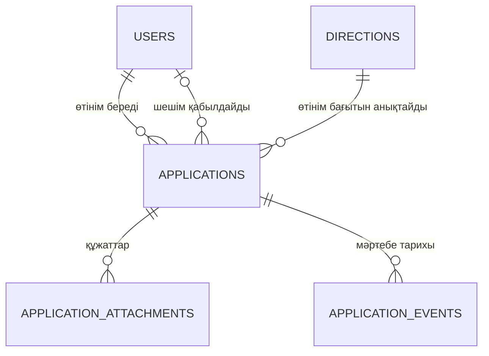

# Мектепке оқушыларды онлайн қабылдау жүйесі

Веб бағдарламалау пәнінің курстық жобасы, №31 нұсқа. Ата-ана қабылдау бағытын таңдайды, өтінім жобасын сақтайды, комиссияға жібереді және шешімді жеке кабинеттен көреді. Комиссия бағыттарды және орын санын басқарады, өтінімдерді іздейді, толықтыруға қайтарады және шешім қабылдайды.

## Windows жүйесінде іске қосу

Python 3.10 немесе жаңа нұсқасын орнатыңыз. Демо нұсқаны ашу үшін `start-mektep.cmd` файлын екі рет басыңыз. Браузерде http://127.0.0.1:8020/ ашылады. **Кіру** бетінде **Демо ата-ана** немесе **Демо комиссия** түймесін басыңыз. Тіркелгілер әр компьютерде бастапқы іске қосуда автоматты түрде жасалады.

| Демо рөлі | Электрондық пошта | Құпиясөз |
| --- | --- | --- |
| Ата-ана | `parent@mektep.example` | `Mektep-Demo31` |
| Қабылдау комиссиясы | `commission@mektep.example` | `Mektep-Demo31` |

Демо деректер бөлек `data/demo/mektep.sqlite3` базасына жазылады. Әр компьютердің демо өтінімдері сол компьютерде сақталады. Демо нұсқа жергілікті компьютерден ғана ашылады.

Кәдімгі нұсқаны `.\start-mektep.cmd normal` пәрменімен іске қосуға болады. Комиссия тіркелгісін жасау немесе серверді қолмен іске қосу үшін PowerShell терезесінде жоба бумасынан орындаңыз.

```powershell
py -m venv .venv
.\.venv\Scripts\python.exe -m pip install -r requirements.txt
.\.venv\Scripts\python.exe manage.py seed
.\.venv\Scripts\python.exe manage.py create-admin commission@example.com
.\.venv\Scripts\python.exe -m uvicorn main:app --host 127.0.0.1 --port 8018
```

- Сайт: http://127.0.0.1:8018/
- Ата-ана тіркелгісі: «Тіркелу» беті.
- Комиссия: жасалған әкімші тіркелгісімен «Кіру» беті арқылы кіріңіз. Парольді `create-admin` пәрмені құпия түрде сұрайды.
- Құжаттама: `/docs` және `/redoc`. Swagger UI-дағы **Authorize** терезесінде пайдаланушы аты ретінде электрондық поштаны енгізіңіз.
- Бұрынғы SQLite базасы алғашқы іске қосуда жаңартылады. Жүйе сақталған мерзімдерден бұрынғы өтінім оқиғаларын қалпына келтіреді. Бұрынғы бағыттарға орын шектеуі автоматты түрде қойылмайды.
- SQLite файлы: `data/mektep.sqlite3`. Бұрынғы MySQL деректері көшірілмеген. `MEKTEP_DATA_DIR` орта айнымалысы дерекқор бумасын өзгертуге мүмкіндік береді.
- `manage.py seed` сегіз үлгі бағытты қосады. Үлгі мерзімдер бағдарламаны тексеру үшін ағымдағы күннен есептеледі. Мектептің нақты қабылдау ережелеріне сәйкес бағыттарды комиссия кабинетінде өңдеңіз.
- Тұрақты JWT кілтін қажет ететін іске қосуда `MEKTEP_JWT_SECRET` орта айнымалысына кемінде 32 кездейсоқ байтқа тең мән орнатыңыз. Айнымалысыз кілт әр процесс іске қосылғанда жаңарады.

## Деректер және API

`users` кестесінде ата-ана мен комиссия тіркелгілері, `directions` кестесінде қабылдау бағыттары, `applications` кестесінде өтінімдер сақталады. Өтінім ата-анаға және бір қабылдау бағытына сыртқы кілттер арқылы байланысады. Бір бағытқа бір ЖСН бойынша бір өтінім сақталады.



| Сценарий | API |
| --- | --- |
| Тіркелу және JWT алу | `POST /api/auth/register`, `POST /api/auth/token` |
| Каталогты іздеу, сүзу, беттеу | `GET /api/directions?q=сынып&grade=1&language=kk&page=1` |
| Бағыттарды басқару | `GET /api/directions/manage`, `POST /api/directions`, `PUT /api/directions/{id}`, `DELETE /api/directions/{id}` |
| Өтінім жобасын сақтау, өзгерту және жіберу | `POST /api/applications`, `PUT /api/applications/{id}`, `POST /api/applications/{id}/submit` |
| Құжаттарды жүктеу, алу және өшіру | `POST /api/applications/{id}/attachments`, `GET /api/applications/{id}/attachments/{file_id}`, `DELETE /api/applications/{id}/attachments/{file_id}` |
| Өтінімдерді іздеу және шешім қабылдау | `GET /api/applications/review`, `GET /api/applications/review/{id}`, `PUT /api/applications/{id}/decision` |

### Өтінімнің қаралу барысы

1. Ата-ана жобаны сақтап, бағыттағы құжат түріне PDF, PNG немесе JPEG файлдарын тіркейді. Бір файл 5 МБ-тан аспайды. Сол құжат түріне жаңа файл жүктелсе, бұрынғы файл ауыстырылады.
2. Жіберілгеннен кейін комиссия файлдарды және тарихты көре алады. Өтінімдерді нөмір, аты-жөні, бағыт, мәртебе және соңғы жіберілген күні бойынша сүзуге болады.
3. Құжаттар немесе деректер толық болмаса, комиссия **Толықтыруға қайтару** шешімін таңдап, себебін жазады. Ата-ана деректерін немесе файлдарын түзетіп, қайта жібере алады. Жіберу, қайтару, қайта жіберу және шешімдер тарихта көрсетіледі.
4. Комиссия мақұлдағанда бос орын болса, өтінім **Қабылданды** күйіне өтеді. Орын болмаса, **Күту тізімінде** күйіне өтеді. Орын саны артқанда комиссия кезектегі өтінімді қолмен қабылдайды. Жүйе кезектің ретін және орын шектеуін тексереді.

### API валидациясын тексеру

Pydantic валидациясын тексеру үшін Swagger UI арқылы жарамды өтінімді жіберіп, кейін `iin` өрісіне 12 цифрдан қысқа мән енгізіңіз. Екінші сұраныста `422` жауабы қайтарылады. Көрсетілімде тек үлгі деректерді қолданыңыз.

Фото: [Katerina Holmes, Pexels](https://www.pexels.com/photo/school-bench-with-stationery-in-classroom-5905445/).
